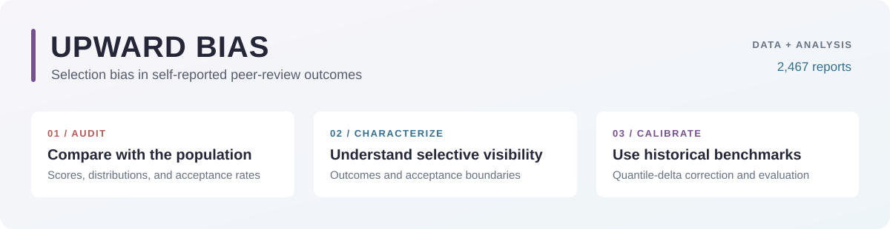
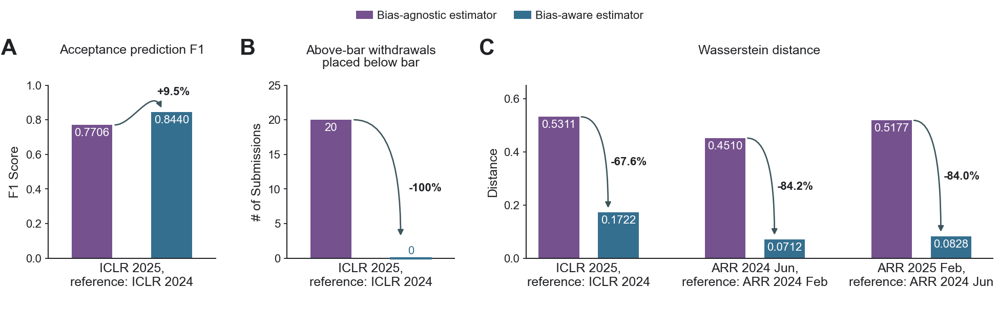

<div align="center">



### Auditing and calibrating selection bias in self-reported peer-review data

**Hangxiao Zhu · Yian Yin · Yu Zhang**

[Paper](https://arxiv.org/abs/2509.16831) &nbsp; / &nbsp; [Quick start](#quick-start) &nbsp; / &nbsp; [Data](#data) &nbsp; / &nbsp; [Reproduce the paper](#reproduce-the-paper) &nbsp; / &nbsp; [Citation](#citation)

</div>

Voluntary reports can give a systematically favorable picture of peer review.
This repository compares public self-reports with population benchmarks,
examines reporting around acceptance boundaries, and tests whether historical
population data can improve estimates from current reports.

| Scope | Included |
| :-- | :-- |
| Self-reports | 2,467 records represented by 1,885 individual rows and 582 aggregated Paper Copilot reports |
| Settings | Three ARR cycles, two ICLR editions, and acceptance-rate comparisons for WWW, KDD, CVPR, and AAAI |
| Reproduction | Four main figures, four supplementary figures, descriptive statistics, and calibration with bootstrap evaluation |

## Quick start

Use **Python 3.10–3.13** in a virtual environment. From the repository root:

```bash
python -m pip install -e .
upward-bias reproduce
```

The second command reads the bundled CSV data, recomputes the analyses and
1,000 bootstrap replicates per comparison, and writes figures and tables to
`outputs/`. It requires no API keys, network downloads, original working
directories, or manual figure assembly.

For a quick run without bootstrap resampling:

```bash
upward-bias reproduce --bootstrap 0
```

## Data

All conferences use the same event identifiers and column conventions. The
small set of CSV files separates observations from aggregate distributions:

| File | Unit of observation | Contents |
| :-- | :-- | :-- |
| [`datasets.csv`](data/processed/datasets.csv) | Conference edition or ARR cycle | Event labels, acceptance benchmarks, and source coverage |
| [`self_reports.csv`](data/processed/self_reports.csv) | Collected self-report | Platform, scores, disclosed decision, and source-row reference |
| [`score_histograms.csv`](data/processed/score_histograms.csv) | Event × source × score × score type | Population and sample score frequencies |
| [`iclr_population.csv`](data/processed/iclr_population.csv) | ICLR submission record | Mean review score and decision status |

**Blank values mean missing information.** They are not zero scores or
rejections. ARR cycles and their associated conferences are related cohorts,
not individually linked submission sets. Paper Copilot reports are available
as histograms, so no individual Paper Copilot records have been invented.

See the [data dictionary](docs/data.md) for field definitions, score resolutions,
decision coding, and the pooled-platform limitation for WWW and KDD. Original
input filenames and checksums are recorded in [`data/provenance.json`](data/provenance.json).

## Reproduce the paper

```bash
upward-bias analyze                 # Statistics, calibration, and bootstrap
upward-bias figures                 # All eight figures, without bootstrap
upward-bias validate                # Check the bundled data
python -m unittest discover -s tests -v
```

`python -m upward_bias` can be used in place of `upward-bias`. Every command
accepts `--data-dir` and `--output-dir` so the package can run from another
working directory.

| Output | Paper item |
| :-- | :-- |
| `outputs/figures/figure1.pdf` | Pooled score CDFs, score summaries, acceptance rates, and platform comparisons |
| `outputs/figures/figure2.pdf` | Reporting proportions, outcome-specific CDFs, and proximity to acceptance bars |
| `outputs/figures/figure3.pdf` | Full-report calibration metrics |
| `outputs/figures/figure4.pdf` | Full-report calibrated CDFs |
| `outputs/figures/figure_s1.pdf` | Score comparisons by iteration and platform |
| `outputs/figures/figure_s2.pdf` | Accepted and rejected ICLR score CDFs by year and platform |
| `outputs/figures/figure_s3.pdf` | Reports without disclosed decisions and score-defined acceptance bars |
| `outputs/figures/figure_s4.pdf` | Calibration using only reports without disclosed decisions |

Each figure is also saved as PNG. Numerical results are written to
`outputs/tables/` as CSV and JSON. Figures are drawn directly from the bundled
data; the preview below is an example output, not a plotting input.

<p align="center">
  
</p>

### Reproducibility notes

- Target and reference Zhihu/Reddit reports are pooled **before** calibration.
- The default bootstrap uses 1,000 replicates, a base seed of `20261101`, and
  the same sample ordering and numerical distance convention as the paper.
- Reports without disclosed decisions are selected by an empty decision field;
  their posting times have not been verified as preceding decision release.
- Plot widths, label sizes, and colors are specified in one shared style file.
  Arial is used when available, with DejaVu Sans as a portable fallback.

The [methods guide](docs/methods.md) explains the estimator, evaluation groups,
and numerical conventions. The environment was verified with Python 3.13,
NumPy 2.2.5, SciPy 1.15.2, and Matplotlib 3.10.3.

## Repository layout

```text
upward-bias/
├── data/
│   ├── processed/          # Four standardized CSV tables
│   └── provenance.json     # Sources, checksums, and conversion notes
├── src/upward_bias/
│   ├── data.py             # Validated CSV loading
│   ├── analysis.py         # Descriptive statistics and analysis outputs
│   ├── calibration.py      # Quantile-delta correction and bootstrap
│   ├── figures/            # Current main and supplementary figures
│   └── style.py            # Shared colors, fonts, and physical dimensions
├── docs/                   # Data dictionary, methods, and README illustrations
├── tests/                  # Data consistency and published-result checks
├── CITATION.cff
└── pyproject.toml
```

## Sources and attribution

Population benchmarks come from [ARR statistics](https://stats.aclrollingreview.org/),
the [ARR health repository](https://github.com/acl-org/arr-health), and
[Paper Copilot's ICLR data](https://github.com/papercopilot/paperlists/tree/main/iclr),
which index OpenReview. Self-reports were collected from conference-specific
Zhihu and Reddit discussions; Paper Copilot supplied structured ARR score
histograms. The quantitative release omits usernames, quoted discussion text,
paper titles, author details, and contact information.

## Citation

Please cite the [arXiv preprint](https://arxiv.org/abs/2509.16831):

```bibtex
@misc{zhu2025survivors,
  title         = {Survivors, Complainers, and Borderliners: Upward Bias in Online Discussions of Academic Conference Reviews},
  author        = {Hangxiao Zhu and Yian Yin and Yu Zhang},
  year          = {2025},
  eprint        = {2509.16831},
  archivePrefix = {arXiv},
  primaryClass  = {cs.SI},
  doi           = {10.48550/arXiv.2509.16831},
  url           = {https://arxiv.org/abs/2509.16831}
}
```
